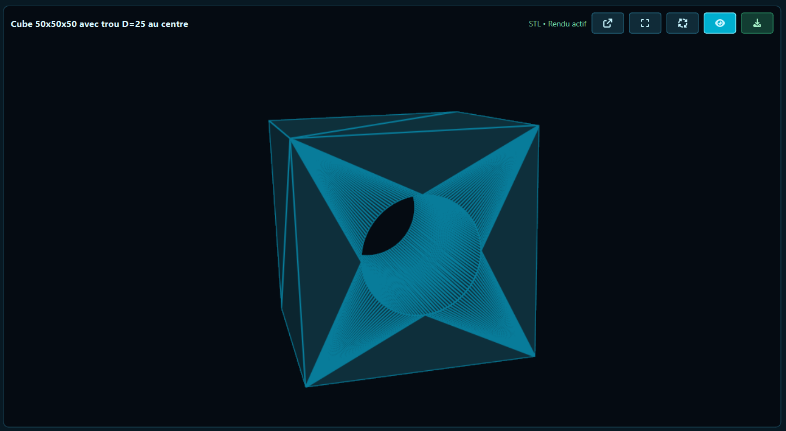

# JARVIS

**JARVIS** est un assistant IA de bureau pour Windows, développé en Python avec PyQt6. Il dialogue avec un modèle servi par **Ollama**, conserve les conversations localement et peut appeler des outils pour calculer, analyser des fichiers, produire des graphiques et des modèles 3D, rechercher sur le Web ou interagir avec le bureau.

> JARVIS orchestre un modèle de langage et des outils locaux : il ne remplace ni un logiciel d'ingénierie spécialisé ni une validation humaine. Les résultats techniques dépendent des données, hypothèses, modèles et logiciels disponibles sur la machine.


## Sommaire

- [Fonctionnalités](#fonctionnalités)
- [Mode ingénieur](#mode-ingénieur)
- [Captures d'écran](#captures-décran)
- [Prérequis](#prérequis)
- [Installation](#installation)
- [Configuration](#configuration)
- [Démarrage](#démarrage)
- [Utilisation](#utilisation)
- [Outils disponibles](#outils-disponibles)
- [Données et confidentialité](#données-et-confidentialité)
- [Sécurité et limites](#sécurité-et-limites)
- [Architecture](#architecture)
- [Dépannage](#dépannage)
- [Développement et tests](#développement-et-tests)
- [Structure du dépôt](#structure-du-dépôt)
- [Contributions et licence](#contributions-et-licence)

## Fonctionnalités

- **Conversation avec Ollama** : réponses en streaming, réflexion facultative selon le modèle, appels d'outils et reprise des conversations précédentes.
- **Interface de bureau** : historique, rendu Markdown et tableaux, blocs de code colorés, panneau d'aperçu et pièces jointes.
- **Mode ingénieur** : instructions techniques à la demande, résolution de systèmes linéaires, simulation RK4 d'équations différentielles et rapports techniques Markdown.
- **Calcul et visualisation** : calculatrice sécurisée, graphiques en ligne ou en barres, séries multiples et visualiseur 3D STL interactif.
- **Outils Python et CAO** : exécution d'un script contrôlée par le runner existant et génération de modèles paramétriques avec CadQuery.
- **Fichiers et mémoire** : espace de travail local, dossiers supplémentaires explicitement autorisés et base de connaissances persistante.
- **Recherche Web** : résultats DuckDuckGo ; Bing ou Google peuvent être ajoutés avec leurs clés API.
- **Automatisation Windows** : capture d'écran, fenêtres ouvertes, lancement d'applications, souris, clavier et notifications.
- **Pièces jointes** : images, fichiers texte et certains documents peuvent être prévisualisés ou transmis au modèle sous forme d'image/texte selon leur format et les bibliothèques installées.

Les capacités exactes dépendent du modèle Ollama choisi, de ses capacités d'appel d'outils, des dépendances installées et de la configuration de la machine.

## Mode ingénieur

Le bouton à icône d'engrenages dans la barre de saisie active le mode ingénieur pour la demande envoyée. L'état sélectionné est visible dans l'interface. Le bouton ajoute au prompt de cette requête des consignes pour :

1. clarifier les données, unités, hypothèses et inconnues importantes ;
2. choisir et combiner les outils techniques disponibles ;
3. vérifier les résultats lorsque c'est possible et signaler explicitement un contrôle échoué ;
4. distinguer les valeurs calculées, les hypothèses et les estimations ;
5. inclure les limites et validations supplémentaires nécessaires.

Le mode peut être défini actif ou inactif au démarrage dans `config.py` :

```python
ENGINEERING_MODE_DEFAULT = True   # Mode actif au lancement
# ENGINEERING_MODE_DEFAULT = False  # Mode inactif au lancement
```

Le bouton reste modifiable dans l'interface. Le choix du bouton s'applique à la requête concernée ; il n'est pas enregistré comme préférence persistante entre les lancements.

### Outils d'ingénierie intégrés

| Outil | Fonctionnement et limites |
|---|---|
| `solve_linear_system` | Résout `Ax=b` pour une matrice carrée de 1 à 20 lignes avec pivot partiel et contrôle du résidu. |
| `simulate_ode` | Intègre jusqu'à 8 équations différentielles du premier ordre avec RK4. Compare la solution à un calcul avec un pas deux fois plus fin ; signale si l'écart dépasse 1 %. |
| `create_technical_report` | Génère un rapport Markdown dans `Jarvis_Workspace/reports/`, avec objectif, hypothèses, méthode, résultats, vérification et limites. |

La simulation accepte des états `y0`, `y1`, etc., le temps `t` et des paramètres numériques. Son contrôle de convergence **n'est pas une validation physique**. Cette première version n'intègre pas de solveurs FEM/CFD, de simulation de circuits, de conception PCB, de cinématique robotique ou de calcul réglementaire. Elle ne produit pas non plus de rapport PDF.

Le mode ingénieur peut également s'appuyer sur `calculate`, `run_python`, `plot_chart` et `create_3d_model`. Les outils Python et CAO restent soumis aux restrictions et limites décrites dans [Sécurité et limites](#sécurité-et-limites). Pour des exemples et précisions supplémentaires, voir [`Docs/engineering.md`](Docs/engineering.md).

## Captures d'écran

| Interface | Fonctionnalité |
|---|---|
|  | Conversation et historique |
|  | Graphiques intégrés à la conversation |
|  | Visualisation interactive d'un modèle 3D |

## Prérequis

- Windows et Python 3 avec `pip`.
- [Ollama](https://ollama.com/) installé et démarré.
- Un modèle Ollama compatible avec le format de conversation et les appels d'outils utilisés par l'application.
- Une connexion Internet seulement pour la recherche Web et les téléchargements.

CadQuery, PyVista et les lecteurs PDF, Word et Excel sont optionnels. Les outils qui les utilisent ne fonctionneront pas si leur dépendance correspondante est absente.

## Installation

Depuis PowerShell, à la racine du dépôt :

```powershell
py -m venv .venv
.\.venv\Scripts\Activate.ps1
python -m pip install --upgrade pip
python -m pip install -r requirements.txt
```

Si l'exécution des scripts PowerShell est bloquée, autorisez-les uniquement pour la session en cours, puis activez l'environnement :

```powershell
Set-ExecutionPolicy -Scope Process -ExecutionPolicy Bypass
.\.venv\Scripts\Activate.ps1
```

Les dépendances déclarées sont dans [`requirements.txt`](requirements.txt). Les fonctions facultatives comprennent notamment :

| Paquets | Usage |
|---|---|
| `cadquery` | Construction et export STL des modèles paramétriques |
| `pyvista` | Visualisation 3D interactive |
| `pypdf` | Extraction du texte des PDF |
| `python-docx` | Extraction du texte des documents DOCX |
| `openpyxl` | Extraction des feuilles des classeurs XLSX |
| `ddgs` | Recherche DuckDuckGo |
| `pyperclip` | Fonctions liées au presse-papiers |

## Configuration

Les réglages principaux se trouvent dans [`config.py`](config.py) :

```python
MODEL = "Jarvis-3.5"
URL = "http://localhost:11434/api/chat"
ENGINEERING_MODE_DEFAULT = True
```

- `MODEL` doit correspondre exactement à un modèle disponible dans Ollama.
- `URL` pointe vers l'API de chat Ollama.
- `ENGINEERING_MODE_DEFAULT` choisit l'état initial du bouton ingénieur.
- Les constantes de limites (durée Python, taille des fichiers et historique) sont également définies dans ce fichier.

Le modèle par défaut est défini dans `config.py`. Deux Modelfiles sont fournis :

- [`Jarvis-3.5`](Jarvis-3.5), basé sur `qwen3.5:9b`.
- [`Jarvis-3.8`](Jarvis-3.8), basé sur `qwen3.8:27b`.

Créez le modèle choisi depuis la racine du dépôt, après avoir installé Ollama et téléchargé son modèle de base :

```powershell
ollama pull qwen3.5:9b
ollama create Jarvis-3.5 -f .\Jarvis-3.5
ollama list
```

Pour créer l'autre variante, récupérez d'abord sa base (`qwen3.8:27b`), puis utilisez `ollama create Jarvis-3.8 -f .\Jarvis-3.8` et changez `MODEL` dans `config.py`.

La recherche Web utilise DuckDuckGo si `ddgs` est installé. Des clés API peuvent activer en plus Bing (`BING_SEARCH_API_KEY`) ou Google (`GOOGLE_SEARCH_API_KEY` et `GOOGLE_SEARCH_ENGINE_ID`). Configurez-les dans l'environnement du processus plutôt que de les inscrire dans le dépôt.

## Démarrage

Démarrez Ollama, vérifiez que le modèle configuré est disponible, puis lancez depuis la racine du projet :

```powershell
ollama list
python main.py
```

L'interface s'ouvre dans une fenêtre maximisée. Elle peut être redimensionnée normalement.

## Utilisation

1. Démarrez une nouvelle conversation depuis la barre latérale ou reprenez une conversation existante.
2. Saisissez une demande ; **Entrée** l'envoie et **Maj+Entrée** ajoute une nouvelle ligne.
3. Utilisez le trombone pour joindre des fichiers. Les pièces jointes prises en charge peuvent être prévisualisées depuis l'interface.
4. Activez le bouton engrenages pour ajouter les consignes du mode ingénieur à cette demande. Le bouton cerveau contrôle séparément la réflexion du modèle lorsque celui-ci la prend en charge.
5. Utilisez le bouton d'arrêt pour interrompre une génération en cours.

Exemples :

- « Calcule 15 % de 248 et explique les étapes. »
- « Résous le système 3x + 2y = 5 et x + 2y = 5. »
- « En mode ingénieur, simule `dy/dt = y`, avec `y(0)=1` sur `[0, 1]`, puis compare à `e`. »
- « Génère un rapport technique Markdown qui documente les hypothèses, les résultats et les limites de cette étude. »
- « Crée un graphique en ligne des ventes mensuelles 12, 18, 15, 24. »
- « Crée une pièce rectangulaire de 40 × 30 × 8 mm percée au centre. »
- « Recherche les nouveautés Python les plus récentes. »
- « Mémorise que mon projet principal s'appelle Atlas. »
- « Liste les fenêtres ouvertes. »

### Pièces jointes

L'application peut extraire du texte depuis des fichiers texte courants (`.txt`, `.md`, `.py`, `.json`, `.csv`, `.xml`, `.html`, `.css`, `.js`, `.log`, `.yaml`, `.yml`, `.ini`), ainsi que depuis les PDF, DOCX et XLSX si les bibliothèques optionnelles correspondantes sont installées. Les images courantes peuvent être envoyées comme images si le modèle les accepte. Pour les autres formats, l'application joint le fichier à la conversation, mais n'en extrait pas automatiquement le contenu.

## Outils disponibles

Les outils sont proposés au modèle par appel de fonction. Le modèle décide lesquels utiliser selon la demande ; leur présence ne garantit pas que chaque modèle les appellera correctement.

| Domaine | Outils |
|---|---|
| Date et calcul | `get_current_datetime`, `calculate` |
| Ingénierie numérique | `solve_linear_system`, `simulate_ode` |
| Rapports | `create_technical_report` (Markdown) |
| Recherche Web | `web_search` |
| Python | `run_python`, `list_python_packages` |
| Fichiers du workspace | `create_file`, `create_folder`, `read_file`, `write_file`, `open_file`, `open_workspace` |
| Dossiers autorisés | `list_managed_files`, `read_managed_file`, `write_managed_file` |
| Sauvegardes | `backup_config`, `restore_config` |
| Mémoire | `knowledge_save`, `knowledge_search`, `knowledge_list` |
| Graphiques et CAO | `plot_chart`, `create_3d_model`, `read_cadquery_guide` |
| Bureau Windows | `capture_screen`, `get_open_windows`, `open_app` |
| Souris | `move_mouse`, `click_mouse`, `mouse_down`, `mouse_up`, `drag_mouse`, `scroll_mouse`, `release_all_mouse_buttons` |
| Clavier et notifications | `type_text`, `press_key`, `hotkey`, `notify_user` |

Les graphiques natifs prennent en charge les lignes et les barres, avec plusieurs séries. La modélisation CAO produit des STL dans le workspace ; l'export et la visualisation dépendent des bibliothèques optionnelles. Voir le guide [`Docs/cadquery.md`](Docs/cadquery.md).

## Données et confidentialité

Par défaut, JARVIS crée `%USERPROFILE%\Jarvis_Workspace` et y stocke ses données :

| Données | Emplacement |
|---|---|
| Conversations et historique | `conversations.sqlite3` |
| Base de connaissances | `jarvis_knowledge.sqlite3` |
| Configuration des dossiers autorisés | `jarvis_config.json` |
| Sauvegardes | `backups/` |
| Modèles 3D exportés | `models/*.stl` |
| Rapports techniques | `reports/*.md` |
| Scripts temporaires du runner | `.jarvis_script_*.py`, `.jarvis_runner_*.py` |

Les dossiers standards accessibles par les outils gérés sont `workspace/`, `documents/`, `downloads/` et `desktop/`. Des dossiers supplémentaires peuvent être autorisés depuis l'interface ; leur autorisation est conservée dans la configuration locale.

Avec Ollama local, les conversations et les appels au modèle restent sur l'ordinateur, sous réserve de la configuration du serveur Ollama. La recherche Web contacte des services Internet ; les résultats obtenus sont renvoyés au modèle. Les données locales ne sont pas chiffrées par JARVIS. Ne stockez pas de mots de passe, clés API ou autres secrets dans les conversations, les fichiers de configuration ou la base de connaissances.

## Sécurité et limites

JARVIS peut lire et écrire des fichiers, lancer des applications et agir sur le bureau. N'accordez l'accès qu'aux dossiers nécessaires et vérifiez les actions avant de lui confier un travail sensible.

- Les chemins des outils de fichiers sont résolus dans le workspace ou un dossier explicitement autorisé ; les chemins absolus et les remontées `..` ne sont pas acceptés par les outils gérés.
- Le runner Python applique des restrictions pratiques sur les écritures, suppressions, accès réseau et processus externes, et impose une durée maximale. **Ce n'est pas une sandbox de sécurité inviolable** : n'exécutez pas de scripts générés sur des systèmes ou données critiques sans revue.
- Les scripts CadQuery passent par ce runner et sont limités en taille et en durée ; les modèles générés doivent être inspectés avant fabrication ou utilisation.
- Les outils de souris et de clavier agissent sur la session Windows active. Les actions peuvent produire des effets réels ; demandez à JARVIS de solliciter une confirmation avant une action conséquente et surveillez l'exécution.
- Les limites du mode ingénieur sont numériques et informatives. Une convergence numérique ne prouve ni l'exactitude du modèle ni la sécurité d'une conception.
- Les pages Web, documents et autres contenus externes sont des données à analyser, pas des instructions fiables.

Cette application n'est pas destinée à certifier une conception ou à remplacer un professionnel qualifié, une simulation métier validée ou des essais physiques.

## Architecture

| Couche | Responsabilité |
|---|---|
| `main.py` | Initialisation DPI et lancement de l'application PyQt |
| `config.py` | Modèle, URL, workspace, limites et état par défaut du mode ingénieur |
| `prompts.py` | Instructions générales et instructions additionnelles du mode ingénieur |
| `Core/agent.py` | Historique, requêtes Ollama en streaming, appels d'outils et reprise |
| `Core/dispatcher.py` | Registre et exécution des outils |
| `Core/conversations.py` | Persistance SQLite des conversations |
| `Core/paths.py` | Résolution du workspace et des dossiers autorisés |
| `Tools/` | Calcul, ingénierie, Python, CAO, graphiques, fichiers, recherche et contrôle Windows |
| `UI/` | Fenêtre principale, worker asynchrone, rendu Markdown, graphiques, aperçus et visualiseur 3D |
| `Docs/` | Guides CadQuery et mode ingénieur |

L'application envoie des requêtes à l'API Ollama configurée avec le streaming activé. Les réponses d'outil sont exécutées par le dispatcher et leurs résultats sont ajoutés au contexte de la conversation.

## Dépannage

### Ollama ne répond pas

Vérifiez qu'Ollama est lancé et écoute à l'adresse configurée :

```powershell
ollama list
curl http://localhost:11434/api/tags
```

Si le serveur est hébergé ailleurs, modifiez `URL` dans `config.py`. Vérifiez aussi qu'un pare-feu ou une autre configuration réseau ne bloque pas la connexion.

### Modèle introuvable ou appels d'outils indisponibles

Comparez `MODEL` dans `config.py` aux noms affichés par `ollama list`. Vérifiez que le modèle a été créé et qu'il prend en charge les appels d'outils utilisés par l'application. Exemple de création :

```powershell
ollama pull qwen3.5:9b
ollama create Jarvis-3.5 -f .\Jarvis-3.5
```

### Une bibliothèque ou une fonction facultative manque

Activez l'environnement virtuel du projet, puis réinstallez les dépendances :

```powershell
.\.venv\Scripts\Activate.ps1
python -m pip install -r requirements.txt
```

CadQuery, PyVista et les lecteurs de documents sont optionnels ; installez seulement le paquet nécessaire si son outil est requis.

### La recherche Web échoue

Vérifiez l'accès Internet et la présence de `ddgs`. Les clés Bing et Google sont facultatives. Si le PC est hors ligne ou si aucun moteur ne renvoie de résultat, JARVIS ne peut pas effectuer la recherche.

### Les PDF, documents ou images ne sont pas analysés

Installez la dépendance de lecture correspondant au format (`pypdf`, `python-docx` ou `openpyxl`). Pour les images, vérifiez que le modèle choisi prend en charge l'entrée visuelle.

### Le modèle 3D ou son aperçu ne s'affiche pas

Vérifiez que `cadquery` est installé pour générer le STL et `pyvista` pour l'affichage interactif. Les erreurs et fichiers produits sont dans le workspace, sous `models/`.

### JARVIS ne détecte pas une fenêtre

Vérifiez que la fenêtre est visible et réessayez avec son titre ou le nom exact de l'application. Les coordonnées d'action doivent correspondre à une capture d'écran récente.

## Développement et tests

Les tests unitaires présents pour les outils d'ingénierie se lancent depuis la racine avec l'environnement du projet :

```powershell
python -m unittest Tests.test_engineering -v
```

Pour vérifier la syntaxe des modules principaux :

```powershell
python -m py_compile Tools\engineering.py Tools\schemas.py Core\dispatcher.py Core\agent.py UI\worker.py UI\main_window.py
```

## Structure du dépôt

```text
Jarvis2.0/
├── main.py
├── config.py
├── prompts.py
├── requirements.txt
├── Jarvis-3.5                 # Modelfile Ollama
├── Jarvis-3.8                 # Modelfile Ollama
├── Core/                      # Agent, conversations, dispatcher, chemins
├── Tools/                     # Outils exécutables par le modèle
├── UI/                        # Interface et composants visuels
├── Docs/
│   ├── cadquery.md
│   └── engineering.md
├── Tests/
│   └── test_engineering.py
├── Images/                    # Captures d'écran
└── Icons/                     # Icônes de l'interface
```

## Contributions et licence

Consultez [`CONTRIBUTING.md`](CONTRIBUTING.md) avant de proposer une modification. Les contributions au projet se font par pull request sur le dépôt officiel.

JARVIS est distribué sous la [Licence JARVIS - Source disponible](LICENSE). Consultez le fichier `LICENSE` pour connaître les droits d'utilisation, de modification et de redistribution.
