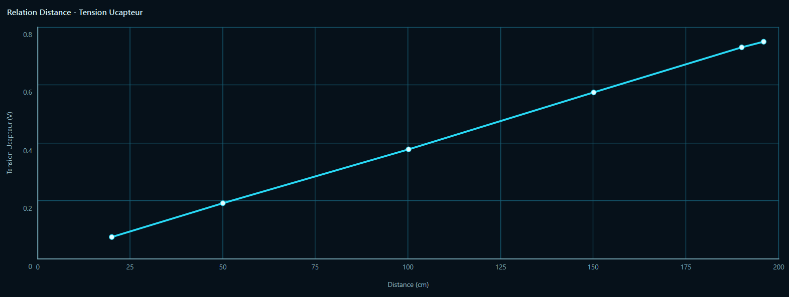

# Jarvis

Jarvis est un assistant IA de bureau pour Windows, développé en Python. Il combine une interface de conversation avec des outils pour aider à effectuer des tâches pratiques : calculs, recherche et gestion de fichiers, graphiques, modélisation 3D et interaction avec le poste de travail.

Les réponses sont générées par un modèle local servi par **Ollama**. Le modèle tourne sur votre machine ; une connexion Internet reste nécessaire pour les fonctions qui consultent le Web.

## Fonctionnalités

- Conversation avec un modèle local via l’API Ollama, avec réponses en continu et appels d’outils.
- Interface graphique de bureau construite avec PyQt6.
- Calculs, base de connaissances locale et gestion de fichiers dans un espace de travail dédié.
- Création de graphiques intégrés à la conversation.
- Génération de pièces 3D avec CadQuery et visualisation des fichiers STL.
- Fonctions Windows telles que capture d’écran, contrôle de la souris et du clavier, notifications et ouverture d’applications.
- Recherche Web facultative avec DuckDuckGo.

## Interface

| Élément | Aperçu |
|:---|:---:|
| Interface générale |  |
| Création de graphe |  |
| Création de modèle 3D |  |
## Prérequis et lancement

- Windows
- Python 3
- [Ollama](https://ollama.com/) installé et démarré
- Un modèle disponible dans Ollama, correspondant au nom configuré dans `config.py` (`Jarvis-3.5` par défaut)

Depuis la racine du dépôt, lancez l’application avec l’environnement Python contenant les dépendances :

```powershell
python main.py
```

Jarvis contacte Ollama à l’adresse `http://localhost:11434/api/chat`. Si votre serveur ou votre modèle utilise une autre adresse ou un autre nom, adaptez `URL` ou `MODEL` dans `config.py`. Vérifiez que le nom de `MODEL` correspond exactement à un modèle installé dans Ollama.

## Bibliothèques Python utiles

Le dépôt ne fournit pas de fichier `requirements.txt` : les bibliothèques nécessaires dépendent notamment des fonctions utilisées. Voici les principales bibliothèques tierces utilisées par l’application ou utiles à ses outils :

| Bibliothèque | Utilisation |
|---|---|
| `PyQt6`, `PyQt6-WebEngine` | Fenêtre de l’application et affichage du contenu formaté |
| `requests` | Communication HTTP avec l’API locale d’Ollama |
| `markdown-it-py`, `Pygments` | Rendu Markdown et coloration syntaxique |
| `pyautogui`, `mss`, `Pillow` | Contrôle souris/clavier et capture d’écran |
| `cadquery` | Création de modèles mécaniques 3D |
| `pyvista` (et `vtk`) | Visualisation des modèles 3D |
| `ddgs` | Recherche Web DuckDuckGo, si cette fonction est utilisée |
| `pyperclip` | Assistance au collage de texte |
| `winotify` | Notifications Windows |
| `pypdf`, `python-docx`, `openpyxl` | Lecture de fichiers PDF, Word et Excel |

Certaines fonctions ne sont disponibles que si leur bibliothèque correspondante est installée. Les modules de la bibliothèque standard, comme `sqlite3`, ne nécessitent aucune installation supplémentaire. Pour voir les packages accessibles dans l’environnement Python de Jarvis, l’outil `list_python_packages()` peut être utilisé.

## Données locales

Jarvis crée son espace de travail dans `%USERPROFILE%\Jarvis_Workspace`. Il y conserve notamment les fichiers de travail, les sauvegardes, la configuration et la base de connaissances SQLite. Les recherches Web nécessitent Internet ; les échanges avec le modèle se font avec le serveur Ollama configuré localement.

## Licence

Ce projet est distribué sous aucune licence.
