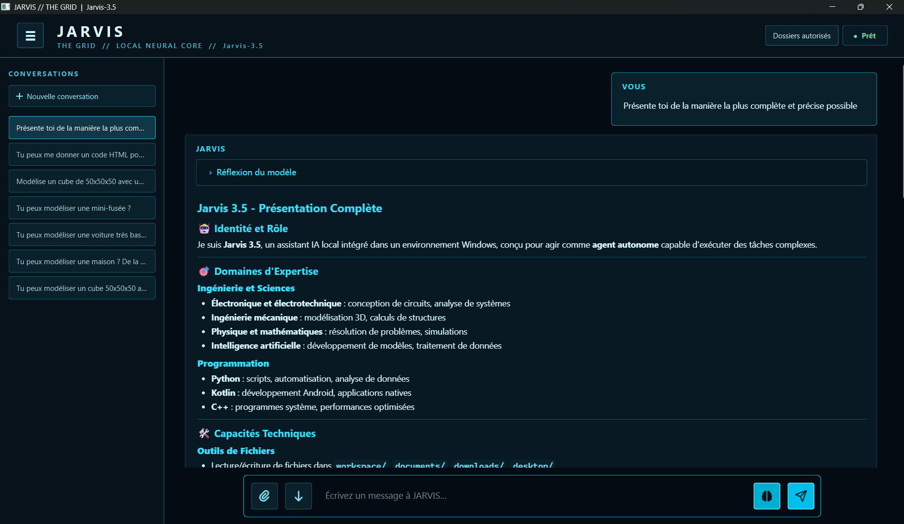

# JARVIS

**JARVIS** est un assistant IA de bureau pour Windows, construit avec Python et PyQt6. Il dialogue avec un modèle local via **Ollama**, conserve l'historique des conversations et peut utiliser des outils pour produire des calculs, manipuler des fichiers, rechercher sur le Web, afficher des graphiques, créer des pièces 3D ou agir sur l'interface Windows.



---

## Sommaire

- [Fonctionnalités](#fonctionnalités)
- [Captures d'écran](#captures-décran)
- [Architecture](#architecture)
- [Prérequis](#prérequis)
- [Installation](#installation)
- [Configuration du modèle Ollama](#configuration-du-modèle-ollama)
- [Lancement](#lancement)
- [Utilisation](#utilisation)
- [Données locales](#données-locales)
- [Sécurité](#sécurité)
- [Dépannage](#dépannage)
- [Structure du projet](#structure-du-projet)
- [Contributions](#contributions)
- [Licence](#licence)

## Fonctionnalités

- **Conversation locale** avec streaming des réponses via l'API Ollama.
- **Historique des conversations** dans une base SQLite, avec renommage, suppression et reprise.
- **Affichage riche** de Markdown, tableaux, blocs de code colorés et fichiers joints.
- **Calculs sécurisés**, date et heure locales.
- **Recherche Web** DuckDuckGo lorsque une connexion Internet est disponible.
- **Gestion de fichiers** dans un espace de travail dédié et dans les dossiers explicitement autorisés.
- **Exécution Python contrôlée** avec accès limité au workspace, délai maximal et blocage des actions réseau, processus externes et suppressions.
- **Base de connaissances persistante** avec recherche, création et consultation d'informations.
- **Graphiques interactifs** en ligne ou en barres intégrés dans la conversation.
- **Modélisation mécanique 3D** avec CadQuery, export STL et visualisation interactive PyVista.
- **Contrôle Windows** : ouverture d'applications, capture d'écran, souris, clavier, défilement et notifications natives.
- **Pièces jointes** : ajout, prévisualisation, ouverture ou téléchargement de fichiers depuis l'interface.

## Captures d'écran

| Interface | Fonctionnalité |
|---|---|
|  | Interface de conversation et historique |
|  | Graphiques intégrés à la conversation |
|  | Visualisation interactive d'une pièce 3D |

## Architecture

| Couche | Rôle |
|---|---|
| `main.py` | Point d'entrée de l'application et initialisation de PyQt6 |
| `config.py` | Modèle Ollama, URL API, limites et chemins locaux |
| `Core/agent.py` | Dialogue streaming, appels d'outils, historique et gestion des erreurs |
| `Core/dispatcher.py` | Validation et exécution centralisée des outils |
| `Core/conversations.py` | Persistance SQLite des conversations |
| `Core/paths.py` | Résolution des chemins autorisés et protection contre les sorties du workspace |
| `Tools/` | Calcul, Web, fichiers, Python, connaissances, graphiques, CadQuery, écran et Windows |
| `UI/` | Fenêtre principale, rendu Markdown, visualiseur 3D, graphiques et worker asynchrone |

Le client envoie les messages à `http://localhost:11434/api/chat` avec le streaming activé. L'application utilise les réponses structurées d'Ollama pour demander des outils, puis incorpore leurs résultats dans la conversation.

## Prérequis

- **Windows**
- **Python 3** avec `pip`
- **Ollama** installé et démarré
- Un modèle compatible avec les **appels d'outils / tool calling**
- Une connexion Internet uniquement pour la recherche Web

CadQuery, PyVista et les bibliothèques de lecture de documents sont optionnelles selon les fonctionnalités utilisées.

## Installation

Depuis une invite PowerShell ouverte à la racine du dépôt :

```powershell
py -m venv .venv
.\.venv\Scripts\Activate.ps1
python -m pip install --upgrade pip
python -m pip install -r requirements.txt
```

Si l'exécution de scripts PowerShell est bloquée par la stratégie Windows :

```powershell
Set-ExecutionPolicy -Scope Process -ExecutionPolicy Bypass
.\.venv\Scripts\Activate.ps1
```

La liste complète des dépendances est disponible dans [`requirements.txt`](requirements.txt).

### Dépendances principales

| Package | Fonction |
|---|---|
| `PyQt6`, `PyQt6-WebEngine` | Interface de bureau et rendu riche |
| `requests` | Communication avec Ollama |
| `markdown-it-py`, `Pygments` | Markdown et coloration syntaxique |
| `PyAutoGUI`, `mss`, `Pillow` | Capture d'écran et contrôle souris/clavier |
| `winotify` | Notifications Windows |
| `cadquery` | Construction paramétrique de pièces 3D |
| `pyvista` | Visualisation interactive des modèles STL |
| `ddgs` | Recherche DuckDuckGo |
| `pyperclip` | Presse-papiers |
| `pypdf`, `python-docx`, `openpyxl` | Lecture PDF, Word et Excel |

## Configuration du modèle Ollama

Le modèle par défaut est configuré dans [`config.py`](config.py) :

```python
MODEL = "Jarvis-3.5"
URL = "http://localhost:11434/api/chat"
```

Deux Modelfiles sont fournis :

- [`Jarvis-3.5`](Jarvis-3.5) — modèle basé sur `qwen3.5:9b`
- [`Jarvis-3.8`](Jarvis-3.8) — modèle basé sur `qwen3.8:27b`

Créez-les depuis Ollama :

```powershell
ollama create Jarvis-3.5 -f .\Jarvis-3.5
ollama create Jarvis-3.8 -f .\Jarvis-3.8
```

Vérifiez les modèles installés :

```powershell
ollama list
```

Pour utiliser un autre modèle local, modifiez `MODEL` dans `config.py`. Le nom doit correspondre exactement à celui reconnu par Ollama. Pour utiliser un serveur Ollama distant, adaptez également `URL`.

## Lancement

Avec Ollama démarré, lancez l'application depuis l'environnement virtuel :

```powershell
python main.py
```

L'application s'ouvre en plein écran. Une fenêtre peut être redimensionnée normalement depuis Windows.

## Utilisation

Dans la barre latérale, utilisez **nouvelle conversation** pour démarrer une session ou sélectionnez une conversation précédente. Le bouton d'arrêt permet d'interrompre la génération en cours.

Exemples de demandes :

- « Quelle heure est-il ? Calcule 15 % de 248. »
- « Crée un graphique en ligne des ventes mensuelles 12, 18, 15, 24. »
- « Recherche les nouveautés Python les plus récentes. »
- « Crée une pièce rectangulaire de 40 × 30 × 8 mm percée au centre. »
- « Mémorise que mon projet principal s'appelle Atlas. »
- « Liste les fenêtres ouvertes, puis ouvre Visual Studio Code. »

Vous pouvez joindre des fichiers avec le bouton trombone. Les images peuvent être envoyées au modèle lorsqu'elles sont prises en charge par celui-ci.

### Outils disponibles

| Catégorie | Outils |
|---|---|
| Temps et calcul | `get_current_datetime`, `calculate` |
| Recherche | `web_search` |
| Python | `run_python`, `list_python_packages` |
| Fichiers | `create_file`, `create_folder`, `read_file`, `write_file`, `open_file`, `open_workspace` |
| Dossiers autorisés | `list_managed_files`, `read_managed_file`, `write_managed_file` |
| Sauvegardes | `backup_config`, `restore_config` |
| Mémoire | `knowledge_save`, `knowledge_search`, `knowledge_list` |
| Visualisation | `plot_chart`, `create_3d_model`, `read_cadquery_guide` |
| Bureau | `capture_screen`, `get_open_windows`, `open_app` |
| Souris | `move_mouse`, `click_mouse`, `mouse_down`, `mouse_up`, `drag_mouse`, `scroll_mouse` |
| Clavier | `type_text`, `press_key`, `hotkey` |
| Notifications | `notify_user` |

Le guide complet CadQuery est disponible dans [`Docs/cadquery.md`](Docs/cadquery.md).

## Données locales

Jarvis crée automatiquement `%USERPROFILE%\Jarvis_Workspace` et y conserve :

| Élément | Emplacement |
|---|---|
| Conversations | `conversations.sqlite3` |
| Connaissances | `jarvis_knowledge.sqlite3` |
| Configuration des dossiers autorisés | `jarvis_config.json` |
| Sauvegardes | `backups/` |
| Modèles 3D | `models/*.stl` |
| Scripts temporaires | `.jarvis_script_*.py`, `.jarvis_runner_*.py` |

Les dossiers Windows standards sont exposés avec les alias `workspace/`, `documents/`, `downloads/` et `desktop/`. Vous pouvez aussi autoriser un autre dossier depuis l'interface avec le bouton d'ajout de dossier.

Les échanges avec Ollama restent locaux lorsqu'un modèle Ollama local est utilisé. Les recherches Web utilisent Internet. Les données stockées ne sont pas chiffrées sur disque ; évitez d'y enregistrer des mots de passe, clés API ou informations sensibles.

## Sécurité

JARVIS est un agent capable d'interagir avec votre bureau. Utilisez-le avec précaution :

- Les opérations sont limitées au workspace et aux dossiers explicitement autorisés.
- Les chemins absolus et les remontées `..` sont bloqués pour les opérations gérées.
- L'exécution Python ne doit pas être considérée comme une sandbox inviolable.
- Les suppressions, processus externes et accès réseau sont bloqués dans le runner Python.
- Une confirmation est demandée ou doit être donnée pour les actions sensibles.
- Vérifiez les scripts générés avant toute utilisation liée à des données ou systèmes critiques.

Ne partagez pas les fichiers `%USERPROFILE%\Jarvis_Workspace\jarvis_config.json`, les bases SQLite ni vos pièces jointes lorsqu'ils peuvent contenir des données privées.

## Dépannage

### Ollama ne répond pas

Vérifiez qu'Ollama est démarré puis testez la connexion :

```powershell
curl http://localhost:11434/api/tags
```

Si le serveur utilise une autre adresse ou un autre port, adaptez `URL` dans [`config.py`](config.py).

### Le modèle configuré est introuvable

```powershell
ollama list
ollama create Jarvis-3.5 -f .\Jarvis-3.5
```

Assurez-vous que la valeur `MODEL` correspond exactement au nom Ollama.

### Une bibliothèque est absente

Réinstallez les dépendances dans l'environnement actif :

```powershell
python -m pip install -r requirements.txt
```

Pour installer uniquement CadQuery et PyVista :

```powershell
python -m pip install cadquery pyvista
```

### La recherche Web échoue

La recherche nécessite une connexion Internet active. Si l'ordinateur est hors ligne, JARVIS devra interrompre cette recherche plutôt que d'inventer des résultats.

### Une fenêtre ou une application n'est pas détectée

Fermez les applications obsolètes, capturez à nouveau l'écran et vérifiez le nom exact de la fenêtre ou de l'application dans Windows.

## Structure du projet

```text
Jarvis2.0/
├── main.py                 # Point d'entrée
├── config.py               # Configuration centrale
├── requirements.txt        # Dépendances Python
├── Jarvis-3.5             # Modelfile Ollama léger
├── Jarvis-3.8             # Modelfile Ollama étendu
├── Core/                   # Agent, dispatcher, chemins et conversations
├── Tools/                  # Outils exécutables par le modèle
├── UI/                     # Interface PyQt6 et composants graphiques
├── Docs/cadquery.md        # Référence CadQuery
├── Images/                 # Captures utilisées dans la documentation
└── Icons/                  # Icônes SVG de l'interface
```

## Contributions

Les propositions de modification sont acceptées uniquement via pull request sur le dépôt officiel. Avant de contribuer, consultez [`CONTRIBUTING.md`](CONTRIBUTING.md).

## Licence

JARVIS est distribué sous la [Licence JARVIS - Source disponible](LICENSE).

Cette licence autorise l'utilisation personnelle ou professionnelle, la consultation du code et sa modification privée. Elle **n'autorise pas la redistribution** du logiciel ou d'une version modifiée. Les modifications doivent être proposées au projet officiel sous forme de **pull request**.
